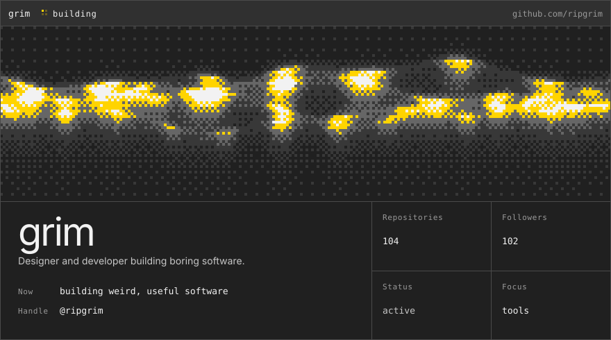
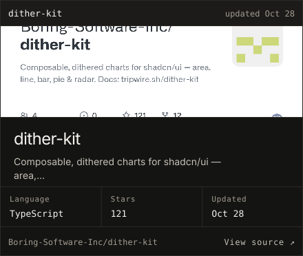
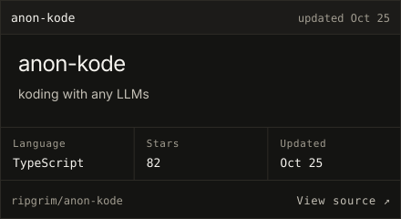
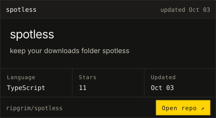
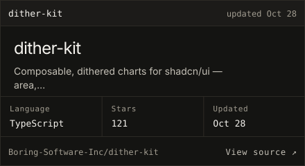
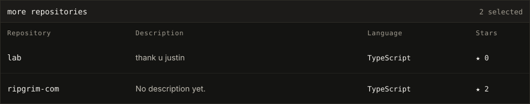
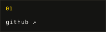
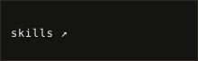
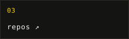
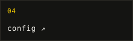

<!-- Generated by scripts/build-profile.mjs. Edit profile.config.json, not this file. -->

generated from <a href="./profile.config.json"><code>profile.config.json</code></a> · repository data refreshes automatically every day

