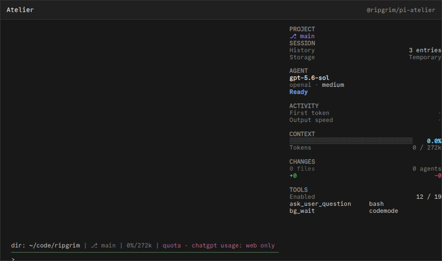

# @ripgrim/pi-atelier

## Atelier Data Sidebar

A data-dense personal behavior fork of the Pi Atelier sidebar.



## Install

Install the public package directly from GitHub:

```bash
pi install git:github.com/ripgrim/ripgrim
```

The repository root is the distributable Pi package and exposes every extension in this suite. Use `pi config` to enable or disable individual resources.

For local development from a clone, this package can also be loaded directly:

```bash
pi install ./pi/extensions/atelier
```

Run `/reload` in an existing Pi session after installation.

## Credit

Forked from **Pi Atelier** by its upstream authors. The vendored fork preserves its upstream license in `vendor/pi-atelier/LICENSE`; local behavior changes are documented in `vendor/pi-atelier/FORK.md` and maintained by [ripgrim](https://github.com/ripgrim).

## Development

This package is part of the personal Pi suite under `pi/`. Shared cross-package helpers live in `../../runtime/`.
