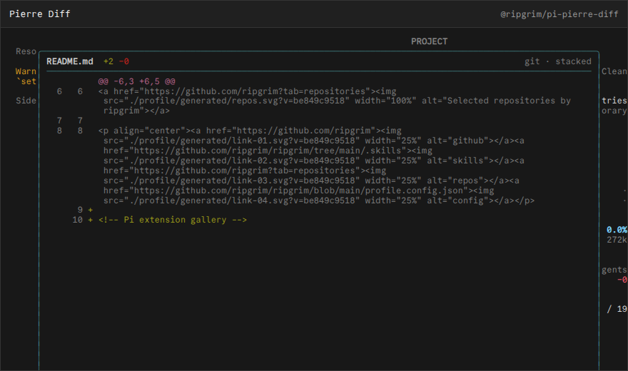

# @ripgrim/pi-pierre-diff

## Pierre Diff

Tracks cumulative session changes plus exact per-tool-call edit patches and opens an agent-aware Changes workspace with Pierre-style diffs. Main-chat and mirrored subagent `edit` headers expose an explicit `[diff]` button for that exact call alongside `[reveal]`; the path itself is inert. Pending, failed, missing, unchanged, or unavailable snapshots report a concise notification.



## Install

Install the public package directly from GitHub:

```bash
pi install git:github.com/ripgrim/ripgrim
```

The repository root is the distributable Pi package and exposes every extension in this suite. Use `pi config` to enable or disable individual resources.

For local development from a clone, this package can also be loaded directly:

```bash
pi install ./pi/extensions/pierre-diff
```

Run `/reload` in an existing Pi session after installation.

## Credit

Personal integration maintained by [ripgrim](https://github.com/ripgrim). It uses the sidebar registration surface from the local Atelier fork and visual conventions from the Pierre ecosystem; it is not an official Pierre package.

## Development

This package is part of the personal Pi suite under `pi/`. Shared cross-package helpers live in `../../runtime/`.
