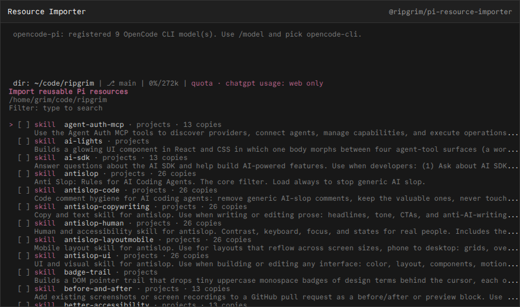

# @ripgrim/pi-resource-importer

## Resource Importer

Discovers and selects reusable project skills and instruction files.



## Install

Install the public package directly from GitHub:

```bash
pi install git:github.com/ripgrim/ripgrim
```

The repository root is the distributable Pi package and exposes every extension in this suite. Use `pi config` to enable or disable individual resources.

For local development from a clone, this package can also be loaded directly:

```bash
pi install ./pi/extensions/resource-importer
```

Run `/reload` in an existing Pi session after installation.

## Credit

Original personal extension maintained by [ripgrim](https://github.com/ripgrim).

## Development

This package is part of the personal Pi suite under `pi/`. Shared cross-package helpers live in `../../runtime/`.
