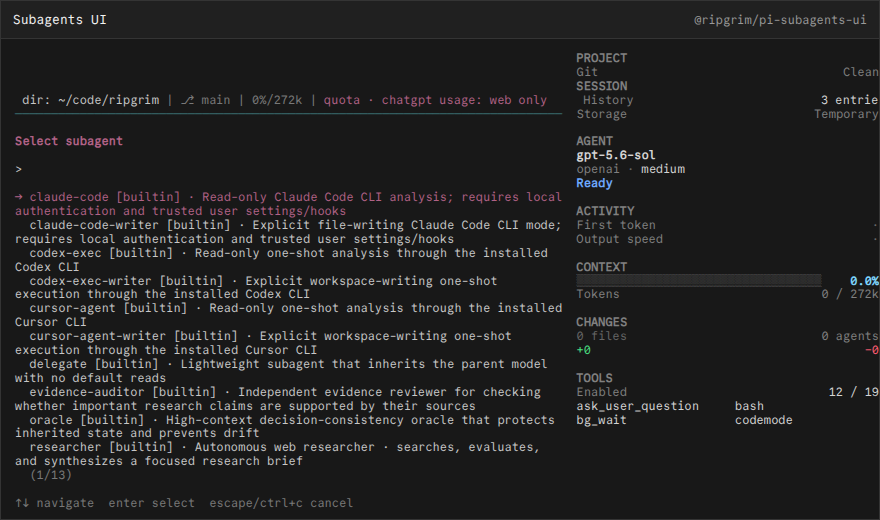

# @ripgrim/pi-subagents-ui

## Subagents UI Fork

Loads the personal behavior fork used for delegation, workflow sibling cycling, and child change attribution.



## Install

Install the public package directly from GitHub:

```bash
pi install git:github.com/ripgrim/ripgrim
```

The repository root is the distributable Pi package and exposes every extension in this suite. Use `pi config` to enable or disable individual resources.

For local development from a clone, this package can also be loaded directly:

```bash
pi install ./pi/extensions/subagents-ui
```

Run `/reload` in an existing Pi session after installation.

## Credit

Forked from [`pi-subagents`](https://github.com/nicobailon/pi-subagents) by **Nico Bailon**, version `0.84.0`, MIT. The vendored source retains upstream package metadata and license; local changes are documented in `vendor/pi-subagents/FORK.md`.

## Development

This package is part of the personal Pi suite under `pi/`. Shared cross-package helpers live in `../../runtime/`.
